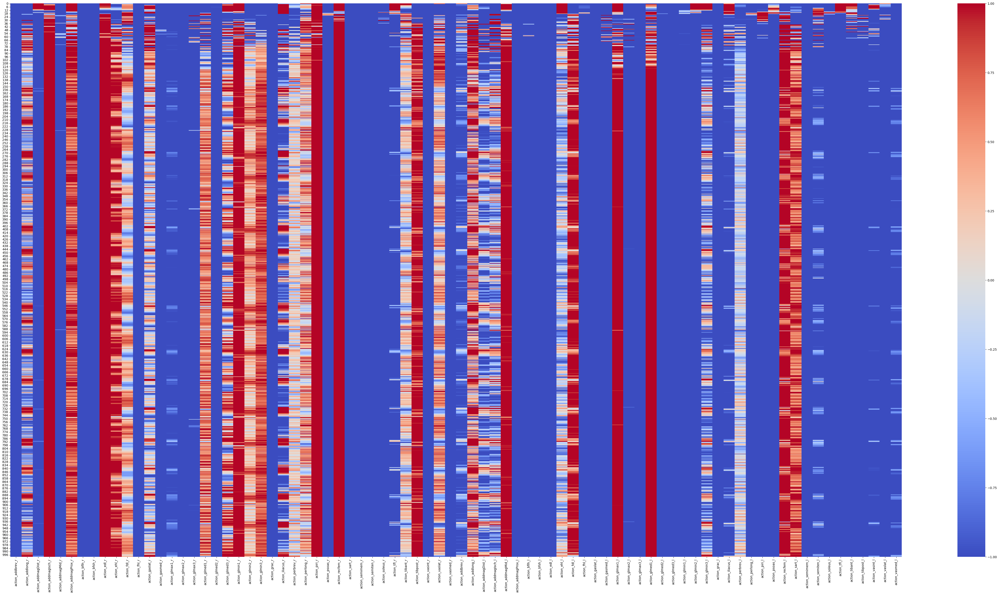
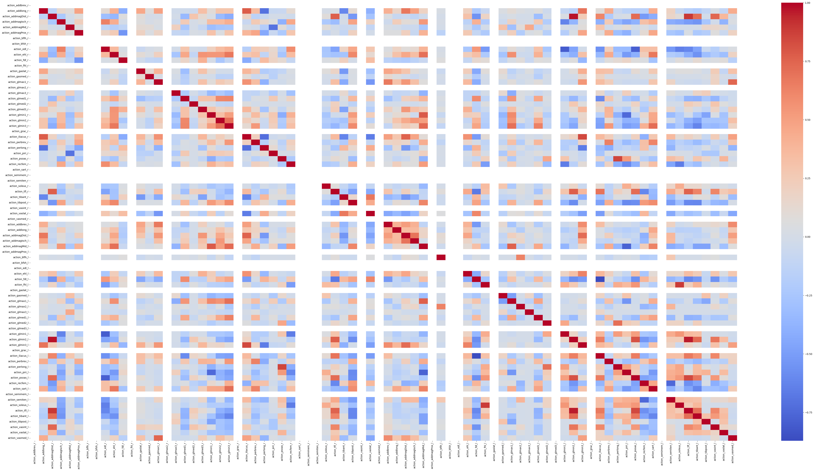

# MyoLeg RL Standing Control

**Reinforcement learning for standing balance in a simulated musculoskeletal leg model.**

This project explores whether a policy learned with **Proximal Policy Optimization (PPO)** can maintain a standing posture in the **MyoSuite MyoLeg** environment, simulated with **MuJoCo**. The main work is a custom standing-control reward and termination wrapper, a PPO training pipeline, and tools for inspecting the resulting muscle-control actions.

> **Project status:** Archived research implementation. The available code resumes training from a previously saved PPO checkpoint; the checkpoint and some logging dependencies are not included. The repository documents the implementation and a recorded rollout, but is **not currently fully reproducible**.

## Overview

| | |
|---|---|
| **Task** | Standing balance in `myoLegStandRandom` |
| **Simulator** | MuJoCo / MyoSuite |
| **RL method** | PPO (Stable-Baselines3) |
| **Control** | Actions applied to the model's musculoskeletal actuators |
| **Episode horizon** | 1,000 environment steps |
| **Analysis** | Per-step action logs, heatmaps, and action correlations |

This is a **simulation of a musculoskeletal leg model**, not a physical-human experiment or a full humanoid robot.

## Method

### 1. Standing environment

The main training script creates the `myoLegStandRandom` task with an initial standing configuration, zero target horizontal velocity, and no joint-initialization randomization (`joint_random_range=(0.0, 0.0)`). It uses 16 parallel environments for PPO training.

### 2. Custom balance reward

The `LongStandingRewardWrapper` in `trainPolicy5.py` reads pelvis height and motion, generalized joint velocities, and the control action. The **active** shaping expression is:

```python
shaping_reward = (
    pelvis_height
    - pelvis_linear_speed
    - pelvis_angular_speed
    - mean_squared_generalized_velocity
    - 3 * mean_squared_action
    + 4
)
```

Here, `pelvis_linear_speed` and `pelvis_angular_speed` are the magnitudes of the pelvis velocities, `mean_squared_generalized_velocity` averages the squared joint/generalized velocities, and `mean_squared_action` averages the squared control actions. The wrapper then applies a fall penalty or episode-completion bonus when applicable and adds a small contribution from the original environment reward:

```python
final_reward = shaping_reward + terminal_adjustment + 0.0001 * environment_reward
```

`terminal_adjustment` is `-100` on detected falls, `+250` when the 1,000-step horizon is reached without termination, and `0` otherwise.

The wrapper **terminates** an episode when pelvis height falls below **0.70 m**, horizontal pelvis-to-target error exceeds **2.0 m**, or vertical error exceeds **0.40 m**. It applies a **−100** fall penalty and a **+250** bonus for reaching the 1,000-step horizon without termination. An uprightness termination criterion appears in the source but is disabled.

### 3. PPO training and evaluation

`trainPolicy5.py` restores a saved PPO model together with `VecNormalize` statistics, then configures continued training, periodic evaluation, and checkpointing. The script requests **50 million additional timesteps**, which is a *configuration value*, not verified evidence of completed training.

`visenv4.py` contains an evaluation/visualization pipeline and per-episode CSV logging. **It has a different action-effort coefficient (1.5 rather than 3)** in its duplicated reward wrapper, so its shaped rewards are not directly comparable to the training rewards.

## Recorded results

One saved notebook output describes a **1,000-step rollout** that reached the episode limit without triggering the wrapper's fall condition (`terminated=False`, `truncated=True`, `fallen=False`). This demonstrates that a recorded episode met the **configured survival criterion**; it does **not** establish a success rate across seeds, robustness to disturbances, or real-world stability.

The following plots examine action commands from a logged episode.

**Action values over an episode** — rows correspond to simulation steps; columns correspond to action channels. Color represents the logged action value.



**Action correlation matrix** — pairwise correlations between action channels in the selected logged columns. These are descriptive relationships, not evidence of causal coordination.



The notebook that generated this analysis is [`process_logs.ipynb`](process_logs.ipynb). Re-running it requires the original episode CSV, which is not included in the available files.

## Repository contents

```text
MyoLeg-RL-Standing-Control/
├── README.md
├── requirements.txt
├── .gitignore
├── trainPolicy5.py             # PPO training continuation + standing reward
├── visenv4.py                  # Evaluation, rendering, and episode logging
├── process_logs.ipynb         # Logged-action analysis notebook
└── results/
    ├── action_heatmap.png
    └── action_correlation_matrix.png
```

## Setup and use

Install the packages listed in the repository's `requirements.txt`:

```bash
python -m pip install -r requirements.txt
```

**To resume training**, the code expects these previously trained artifacts:

```text
models/ppo_standing/best/best_model.zip
models/ppo_standing/vecnormalize.pkl
```

When the compatible saved files and dependencies are available:

```bash
python trainPolicy5.py
```

**To run the evaluation script**, you also need `episode_csv_logger_wrapper.py`, which is imported by `visenv4.py` but was not included in the recovered files. Once that implementation and the saved model files are restored:

```bash
python visenv4.py
```

These commands have **not** been verified on a clean installation. `trainPolicy5.py` is a *continuation* script, not a standalone from-scratch training entry point.

## Current limitations

- Trained PPO checkpoint, normalization statistics, and the CSV-logging wrapper are missing from the shared files.
- The raw episode CSV needed to reproduce the notebook plots is unavailable.
- Training and evaluation currently have different reward implementations.
- Results from repeated evaluations, different initial conditions, and external disturbances were not provided.
- The supplied MuJoCo logs include numerical-instability warnings; additional validation is required before claiming robust performance.

## Acknowledgments

Built on the open-source **[MyoSuite](https://github.com/MyoHub/myosuite)** musculoskeletal simulation environments, **[MuJoCo](https://mujoco.org/)** physics engine, and **[Stable-Baselines3](https://github.com/DLR-RM/stable-baselines3)** reinforcement learning library. The underlying MyoLeg model is provided by MyoSuite.
